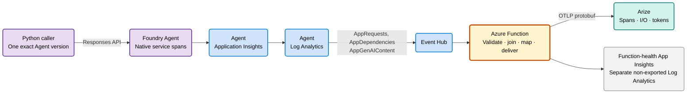

# Foundry Agent telemetry → Arize

A **synthetic-data-only technical preview** of an Azure Function that turns native
Microsoft Foundry Agent telemetry into OpenTelemetry/OpenInference spans for Arize.
Use an **existing, versioned Foundry Agent** and an approved existing Azure environment.
This is not a turnkey fresh deployment or a production-readiness claim.

## Architecture

The **native service spans**, not the caller's local client span, are the subject of
this demo. Linking Foundry to Application Insights and exporting all three tables
are prerequisites; installing the Python caller does not configure native tracing.

## The Function is the sample's focal point

| Stage | Responsibility | Source |
| --- | --- | --- |
| Admit | `TelemetryTransform` receives Event Hub records, enforces the exact source scope and persists them before successful return. | [Triggers](src/telemetry-pipeline/telemetry_pipeline/function_app.py) |
| Map | Validate trace/span/parent IDs; preserve supported timing, status, model, correlation and actual token fields without inventing missing values. | [Mapper](src/telemetry-pipeline/telemetry_pipeline/mapping.py) |
| Join | Persist a Blob ledger and join separately arriving content **to its original span**, with a 300-second first-admission deadline and explicit/inline content precedence. | [Correlator](src/telemetry-pipeline/telemetry_pipeline/durable.py), [ledger](src/telemetry-pipeline/telemetry_pipeline/durable_store.py) |
| Deliver | `DurableGenAIOutbox` drains bounded work every 30 seconds, freezes OTLP bytes, records confirmed acknowledgment and quarantines uncertain delivery. | [Strict sender](src/telemetry-pipeline/telemetry_pipeline/strict_sender.py) |

There is one durable delivery path: no direct/console exporter mode, whole-trace
assembly, content-created spans or model invocation inside the Function.

## Try it

1. Follow [setup](docs/current-state/setup.md) to install locally and validate an
   invocation with `python -m prompt_agent.foundry_responses ... --dry-run`.
   Dry-run makes no authentication, model, Azure or Arize call.
2. Only with separate approval, an approved managed-identity runner can invoke
   the exact existing Agent version once using `--allow-live`. The caller sends
   this fixed prompt, with tools disabled:

   > SYNTHETIC DEMO ONLY. Reply with one short sentence: this is a fabricated benefits enquiry.

3. For an approved real invocation, inspect the destination project in Arize:
   find the native AGENT/LLM spans using the **native source trace ID**; check
   nonempty synthetic input/output, model, parent linkage and prompt/completion
   token counts against that same source invocation. Do not substitute the
   caller's client trace ID or label a calculated total as a source total.
   The [mapping contract](docs/current-state/mapping-and-limitations.md) explains
   what can and cannot survive.

## What has been demonstrated?

A previous real synthetic Foundry invocation reached Arize with nonempty native
input/output and actual prompt/completion usage. Native `AppGenAIContent` transport
was observed, but valid inline content won precedence. **Missing-inline fallback
was demonstrated separately with controlled Event Hub fixtures**, not a native
missing-inline Agent invocation. Neither observation proves complete trace graphs,
full resource parity, exactly-once delivery or readiness of this simplified source
in a new environment.

Function-health telemetry has been physically isolated into a non-exported workspace.
The additional source/backlog guard is offline-tested source, **not deployed live
proof**. Fresh/repeat deployment and private agent-runtime validation remain unverified.

## Read next

- [Setup](docs/current-state/setup.md): prerequisites, safe dry-run and live approval boundary.
- [Mapping and limitations](docs/current-state/mapping-and-limitations.md): fields, joining and evidence scope.
- [Operations](docs/current-state/operations.md): configuration, delivery outcomes and recovery.

Use fabricated content only; keep secrets in Key Vault and prefer managed identities.
Never commit credentials, live configuration or raw telemetry. Earlier documentation
is recoverable from Git tag `minimal-preview-baseline-20261021`; it is not a second
supported setup path.
