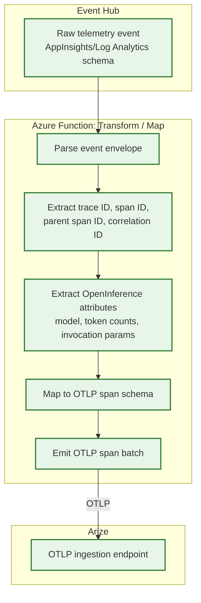

# Current-State Architecture

**Status (2026-10-19): implemented telemetry bridge with bounded #139/#143
evidence; fresh modern private foundation validation PENDING.**
Diagrams show the implemented path, not proof of same-invocation delivery or destination
parity. See the [mapping/export contract](telemetry-mapping-export-contract.md) for the
canonical behavior, source-package reconciliation and separate evidence gates. For
the conceptual direct-OTLP proposal, see [`/docs/future-state`](../future-state/README.md) instead
— it is **not** implemented and must never be confused with this page.

The end-to-end overview diagram lives in the root
[`README.md`](../../README.md#architecture), including the separate Function-health
monitoring path. This page retains foundation details, the transform zoom and known
limitations. Earlier blanket validation summaries elsewhere in the repository are
historical, not independent end-to-end proof.

## Foundation: fresh, adopt and retire are distinct

[ADR-0004](../adr/0004-modern-only-foundry-foundation-and-cleanup-boundaries.md)
accepts **one modern-only private fresh path** through `infra/main.bicep`,
replacing classic ML Hub/project setup and public-default profiles. Infra reports
source implementation and offline checks complete, **Ready for Validation**, not
Validated; provider acceptance, private reachability, fresh idempotence and
end-to-end runtime validation are **PENDING**. The diagrams below describe the
telemetry bridge, not a newly verified deployable foundation.

The required fresh graph is a private `AIServices` account (S0), distinct modern
project MI, one account model deployment, account PE/DNS, private KV/keyless host
storage, Premium Function outbound VNet integration and the telemetry
infrastructure. Modern account/project/model types use API `2025-09-01`.
The project endpoint uses
`https://<customSubDomainName>.services.ai.azure.com/api/projects/<projectName>`
in Azure public cloud; an ML discovery URL is not this interface.
Model deployment alias and catalog name/version are separate inputs.

Account + project + model does **not** establish agent-version publication,
private agent runtime/state readiness or conversation/file recovery. Model
quota/residency/cost, network ownership, approved ingestion/export/Arize egress,
secure immutable KV connection resolution and exact agent API/tool requirements
remain operator gates. No Search, Cosmos DB, ACR, capability host, VM or additional
permissions are automatically implied. A Foundry PE does not privatize Monitor.
See [current operations](runbooks.md) for these gates; there is no public fallback.

**Existing-resource adoption** retains the narrow
[#139 connection-only entrypoint](foundry-appinsights-tracing.md) and
[#143 durable rollout](durable-genai-correlation.md). Neither is fresh foundation
creation or permission to run main over the mixed live RG. Preserve exact names,
identities, model, state and checkpoints. **Retirement** is separately gated by
the [cleanup plan](resource-cleanup-plan.md); removing classic source neither
deletes resources nor certifies them unused.

## End-to-End Pipeline

See the [overview diagram in the main README](../../README.md#architecture).

**Implementation flow (live delivery and destination parity require separate evidence):**
1. The Foundry Prompt Agent emits spans/traces using OpenTelemetry, with LLM-specific attributes
   following OpenInference semantic conventions (model name, prompt/completion token counts,
   invocation parameters).
2. Telemetry is exported to Application Insights (and its backing Log Analytics workspace).
3. Native LAW data export targets an explicit Event Hub namespace and hub name.
   The accepted live durable rollout includes AppDependencies, AppRequests and
   AppGenAIContent; configuration alone is not per-event delivery proof.
4. An Azure Function consumes the Event Hub stream, transforms/maps the schema, and forwards it to
   Arize via OTLP.
5. Arize ingestion, correlation and visualization are separate destination checks.
   [#143 evidence](durable-genai-correlation.md) establishes bounded native
   transport/inline precedence and generated-fixture missing-inline fallback,
   not universal parity or a newly validated fresh environment.

Trace ID, span ID, parent span ID and supplied correlation ID must be preserved wherever
available. Synthetic tests cover mapping/encoding, not every live hop. Missing source fields
cannot be reconstructed; see "Known Limitations" and the canonical contract.

## Zoomed View: Event Hub → Azure Function Transform

This is the schema-mapping step with the highest risk of field loss, so it is broken out
separately. The Azure Function consumes raw Log Analytics/Application Insights telemetry events
from the Event Hub, maps them into valid OTLP spans, and forwards the result to Arize.

**Mapping notes:**
- Trace ID, span ID and parent span ID come from native row fields
  `OperationId` / `Id` / `ParentId` or legacy `operation_Id` / `id` /
  `operation_ParentId`, not invented custom dimensions. Conflicting aliases reject the row.
- The correlation ID (a custom dimension set by the Prompt Agent at invocation time) is mapped onto
  an OTLP span attribute so it survives into Arize for cross-system correlation.
- Prompt/completion/total token counts are mapped onto OTLP span attributes using the same
  OpenInference-aligned attribute keys emitted by the Prompt Agent, to minimize transform
  complexity (see §10 of `copilot-instructions.md`).

## Known Limitations

- Complete graph, custom-correlation, source-total and OTLP resource parity are
  **UNKNOWN**. The #143 native case has bounded source/destination evidence;
  native missing-inline fallback was not observed. The generated fixture proves
  the deployed fallback branch, not exactly-once delivery. Historical
  2026-10-16 package-only receipts do not validate the new fresh foundation.
- Only supported span rows are mapped; AppTraces/AppExceptions are not reconstructed as spans
  or exception events. Original status/kind is best effort. Missing parents, content, correlation
  or total usage cannot be recreated; malformed rows can leave graph gaps.
- Fresh binding/consumer-group, routing, private network/identity and package
  configuration require independent review and live evidence. Explicit group
  selection is required; the source `$Default` fallback is not proof of alignment.
- Inline conversion and opt-in durable content correlation are implemented;
  durable admission is enabled in the approved existing demo. Preserve its
  ledger/index/35 imported ACKs, checkpoints and ambiguous-send quarantine.
  No blind resend, replay, model, deployment, evaluation or live deletion is
  authorized by this diagram. See the root README for closed runtime guards.
- Diagram styling follows the solid-line/solid-box convention for current-state diagrams only (see
  `copilot-instructions.md` §17). It must never be reused for future-state/conceptual diagrams.
