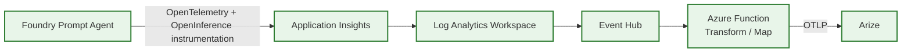
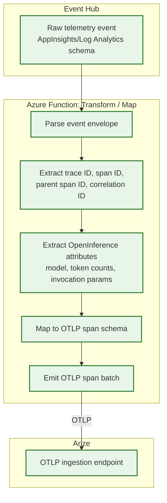

# Current-State Architecture

**Status: CURRENT-STATE implementation; NOT independently E2E validated (2026-10-16).**
Diagrams show the implemented path, not proof of same-invocation delivery or destination
parity. See the [mapping/export contract](telemetry-mapping-export-contract.md) for the
canonical behavior, source-package reconciliation and separate evidence gates. For
the conceptual direct-OTLP proposal, see [`/docs/future-state`](../future-state/README.md) instead
— it is **not** implemented and must never be confused with this page.

This diagram set is the current-state picture referenced from the root
[`README.md`](../../README.md). Earlier blanket validation summaries elsewhere in the
repository are historical, not independent end-to-end proof.

## End-to-End Pipeline

**Implementation flow (live delivery and destination parity require separate evidence):**
1. The Foundry Prompt Agent emits spans/traces using OpenTelemetry, with LLM-specific attributes
   following OpenInference semantic conventions (model name, prompt/completion token counts,
   invocation parameters).
2. Telemetry is exported to Application Insights (and its backing Log Analytics workspace).
3. Log Analytics streams relevant telemetry to an Event Hub.
4. An Azure Function consumes the Event Hub stream, transforms/maps the schema, and forwards it to
   Arize via OTLP.
5. Arize ingestion, correlation and visualization are destination checks, not established by
   the implementation diagram.

Trace ID, span ID, parent span ID and supplied correlation ID must be preserved wherever
available. Synthetic tests cover mapping/encoding, not every live hop. Missing source fields
cannot be reconstructed; see "Known Limitations" and the canonical contract.

## Zoomed View: Event Hub → Azure Function Transform

This is the schema-mapping step with the highest risk of field loss, so it is broken out
separately. The Azure Function consumes raw Log Analytics/Application Insights telemetry events
from the Event Hub, maps them into valid OTLP spans, and forwards the result to Arize.

**Mapping notes:**
- Trace ID, span ID and parent span ID come from native row fields
  `OperationId` / `Id` / `ParentId` or legacy `operation_Id` / `id` /
  `operation_ParentId`, not invented custom dimensions. Conflicting aliases reject the row.
- The correlation ID (a custom dimension set by the Prompt Agent at invocation time) is mapped onto
  an OTLP span attribute so it survives into Arize for cross-system correlation.
- Prompt/completion/total token counts are mapped onto OTLP span attributes using the same
  OpenInference-aligned attribute keys emitted by the Prompt Agent, to minimize transform
  complexity (see §10 of `copilot-instructions.md`).

## Known Limitations

- Independent same-invocation Arize graph/field/token parity is **UNKNOWN**. The 2026-10-16
  Function publication used a package-only approval exception, not completed generic validation.
- Only supported span rows are mapped; AppTraces/AppExceptions are not reconstructed as spans
  or exception events. Original status/kind is best effort. Missing parents, content, correlation
  or total usage cannot be recreated; malformed rows can leave graph gaps.
- Baseline infrastructure is retained, but binding, consumer-group selection, routing and
  network/identity configuration require operator review. Held infrastructure/settings are not
  included; the source consumer-group fallback remains `$Default`.
- Content conversion is proposal only. Publication, tests and this diagram authorize no live
  deployment, replay, model or evaluation action. See the root README for closed runtime guards.
- Diagram styling follows the solid-line/solid-box convention for current-state diagrams only (see
  `copilot-instructions.md` §17). It must never be reused for future-state/conceptual diagrams.
